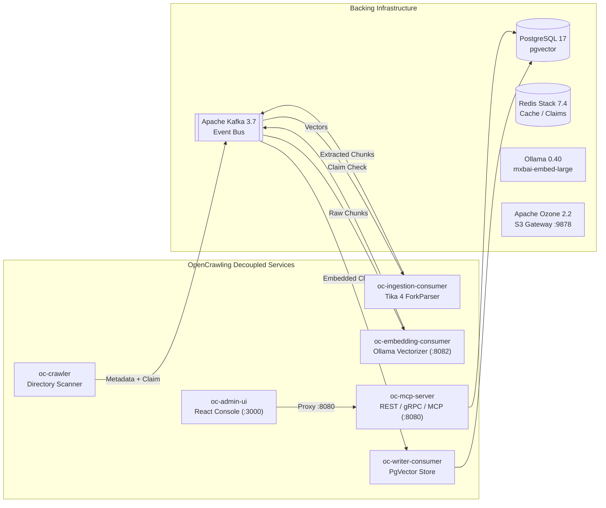

# OpenCrawling — User & Installation Guide

Welcome to the comprehensive **OpenCrawling User & Installation Guide**. This document provides end-to-end instructions for deploying, running, configuring, and administering OpenCrawling using both **pre-built Docker Hub container stacks** and **bare-metal / Virtual Machine (VM) distribution ZIP packages** released with every version.

---

## 📑 Table of Contents

1. [Executive Summary & Architecture Overview](#1-executive-summary--architecture-overview)
2. [Release Assets Overview](#2-release-assets-overview)
3. [Running via Docker Hub Release Assets (`*-dockerhub.yml`)](#3-running-via-docker-hub-release-assets--dockerhubyml)
   - [Prerequisites](#31-prerequisites)
   - [Mode 1: Complete Decoupled Pipeline (`docker-compose-decoupled-dockerhub.yml`)](#32-mode-1-complete-decoupled-pipeline-docker-compose-decoupled-dockerhubyml)
   - [Mode 2: Application Stack (`docker-compose-apps-dockerhub.yml`)](#33-mode-2-application-stack-docker-compose-apps-dockerhubyml)
   - [Verifying Ingestion & PgVector Records](#34-verifying-ingestion--pgvector-records)
   - [Stopping and Teardown](#35-stopping-and-teardown)
4. [Installing via VM & Bare-Metal Distribution ZIP Packages](#4-installing-via-vm--bare-metal-distribution-zip-packages)
   - [Prerequisites (Java 25)](#41-prerequisites)
   - [Distribution Packages Breakdown](#42-distribution-packages-breakdown)
   - [Step-by-Step Installation on Linux / macOS](#43-step-by-step-installation-on-linux--macos)
   - [Step-by-Step Installation on Windows Server](#44-step-by-step-installation-on-windows-server)
   - [Production `systemd` Service Setup](#45-production-systemd-service-setup)
   - [OpenCrawling CLI (`oc`) Management](#46-opencrawling-cli-oc-management)
   - [Java Client SDK (`oc-java-client-sdk`) Integration](#47-java-client-sdk-oc-java-client-sdk-integration)
5. [Web Administration & Control Plane (`oc-admin-ui`)](#5-web-administration--control-plane-oc-admin-ui)
   - [Telemetry Dashboard](#51-telemetry-dashboard)
   - [Job Pipeline Scheduler & AIOps Diagnostics](#52-job-pipeline-scheduler--aiops-diagnostics)
   - [Connector Registry Configuration](#53-connector-registry-configuration)
   - [Interactive OpenAPI 3.1 & Swagger UI](#54-interactive-openapi-31--swagger-ui)
6. [Secure Model Context Protocol (MCP) Server & AI Integration](#6-secure-model-context-protocol-mcp-server--ai-integration)
   - [Connecting AI Clients (Claude Desktop, Cursor, Continue)](#61-connecting-ai-clients)
   - [Zero-Trust ACL & Security SID Evaluation](#62-zero-trust-acl--security-sid-evaluation)
7. [Lakehouse Audit Reporting & Ledger](#7-lakehouse-audit-reporting--ledger)
8. [Troubleshooting & Frequently Asked Questions](#8-troubleshooting--frequently-asked-questions)

---

## 1. Executive Summary & Architecture Overview

**OpenCrawling** is a high-performance, enterprise-grade data ingestion, federation, and security mapping framework. Built on **Java 25** (with Virtual Threads / Project Loom) and **Spring AI**, OpenCrawling bridges enterprise content repositories (Alfresco, SharePoint, CMIS, M-Files, Doxis, JDBC, OpenArch, StormCrawler) to downstream AI platforms, vector databases, and Retrieval-Augmented Generation (RAG) applications.

### Core Architectural Pillars

1. **🔒 Zero-Trust Security & ACL Federation**: Synchronizes native Access Control Lists (ACLs) and Security SIDs (Security Identifiers). Downstream vector search queries are filtered so users only retrieve documents they are strictly authorized to read.
2. **⚡ Asynchronous Decoupled Microservices**: Heavy extraction and embedding workloads are decoupled across **Apache Kafka** event streams (`opencrawling-ingestion`, `opencrawling-chunks`, `opencrawling-embedded`), preventing slow text extraction or AI embedding from blocking ingestion crawlers.
3. **📦 Claim-Check Pattern**: Large binary payloads (PDFs, Office files, videos) are offloaded to high-throughput object storage (**Apache Ozone** or shared disk), passing lightweight metadata pointers through Kafka to conserve broker bandwidth.
4. **🛡️ Apache Tika 4.x Process-Isolated ForkParser**: Document parsing runs in isolated child JVM processes monitored by watchdog timers, protecting the core workers from native parser crashes, infinite loops, and memory leaks.
5. **🤖 Standardized MCP Tool Surface**: Exposes an enterprise **Model Context Protocol (MCP)** server over HTTP Streamable transport (`/mcp`), enabling Claude Desktop, Cursor, Continue.dev, and autonomous AI agents to perform secure vector retrieval.

---

## 2. Release Assets Overview

Every OpenCrawling release and release candidate publishes ready-to-run distribution packages attached directly to the GitHub Release:

| Release Asset File | Description | Purpose |
| :--- | :--- | :--- |
| **`docker-compose-decoupled-dockerhub.yml`** | Full decoupled multi-service stack using pre-built Docker Hub images | Instant deployment of the complete platform + backing services without compiling source code |
| **`docker-compose-apps-dockerhub.yml`** | Application-tier services (`oc-mcp-server`, `oc-embedding-consumer`, `oc-admin-ui`) | Deploying application services on top of pre-existing infrastructure |
| **`opencrawling-platform-dist-<version>.zip`** | Full VM / Bare-Metal Platform Distribution bundle (~745 MB) | Complete standalone deployment on Linux, Windows Server, or macOS VMs without Docker |
| **`opencrawling-runtime-dist-<version>.zip`** | Core Runtime / Worker Node distribution bundle (~459 MB) | Dedicated Crawler, Tika Ingestion Consumer, Writer Consumer, or MCP server VMs |
| **`opencrawling-embedding-service-dist-<version>.zip`** | Stateless Spring AI Embedding microservice bundle (~192 MB) | Dedicated embedding worker VMs scaling Ollama or OpenAI inference |
| **`opencrawling-admin-ui-dist-<version>.zip`** | Pre-built React 19 Admin UI static bundle + Nginx configuration (~275 KB) | Deploying the web dashboard on Nginx, Apache HTTP Server, or cloud CDNs |
| **`opencrawling-cli-dist-<version>.zip`** | Standalone OpenCrawling CLI distribution bundle (~95 MB) | Command-line management with bundled `bin/oc` launcher on admin workstations and bastion hosts |
| **`oc-cli-<version>.jar`** | Standalone executable CLI fat JAR (~104 MB) | Direct CLI execution via `java --enable-preview -jar oc-cli-<version>.jar` without extraction |
| **`SHA256SUMS.txt` & `*.sha256`** | Cryptographic SHA-256 checksums | Integrity and supply-chain security verification |
| **`OpenCrawling-User-and-Installation-Guide.pdf`** | Standalone PDF User & Installation Guide | Offline documentation for air-gapped systems and enterprise compliance |

---

## 3. Running via Docker Hub Release Assets (`*-dockerhub.yml`)

The `*-dockerhub.yml` compose manifests allow developers, DevOps engineers, and system administrators to run OpenCrawling immediately using official, multi-architecture (`linux/amd64` and `linux/arm64`) container images published to **Docker Hub**.

### 3.1 Prerequisites

* **Docker Engine**: Version 24.0 or newer.
* **Docker Compose**: Docker Compose Plugin v2 (`docker compose`, not legacy `docker-compose`).
* **System Resources**:
  * Minimum **8 GB RAM** allocated to Docker Engine (16 GB recommended for local Ollama LLM/embeddings).
  * Minimum **10 GB free disk space** for vector stores, Kafka logs, and Ollama embedding models (`mxbai-embed-large`).

---

### 3.2 Mode 1: Complete Decoupled Pipeline (`docker-compose-decoupled-dockerhub.yml`)

This mode starts the complete enterprise architecture, including all five decoupled microservices and the full backing infrastructure stack:



#### Step 1: Download the Compose Manifest
Download `docker-compose-decoupled-dockerhub.yml` directly from GitHub:
```bash
curl -LO https://raw.githubusercontent.com/OpenCrawling/opencrawling/main/docker-compose-decoupled-dockerhub.yml
```
*(Alternatively, download it from the GitHub Release assets for your specific version, e.g. `https://github.com/opencrawling/opencrawling/releases/download/<version>/docker-compose-decoupled-dockerhub.yml`)*

#### Step 2: Start the Pipeline
```bash
docker compose -f docker-compose-decoupled-dockerhub.yml up -d
```

#### Step 3: Monitor Health & Service Status
Verify that all containers are healthy and running:
```bash
docker compose -f docker-compose-decoupled-dockerhub.yml ps
```

The stack exposes the following services and endpoints:

| Container Name | Service Image | Published Port | Functionality |
| :--- | :--- | :--- | :--- |
| `oc-admin-ui-service` | `opencrawling/oc-admin-ui:latest` | `3000:80` | **Web Management Dashboard** (React 19 SPA) |
| `oc-mcp-server-service` | `opencrawling/oc-mcp-server:latest` | `8080:8080`<br/>`9095:9095`<br/>`9096:9096` | **Secure MCP Server** (`/mcp`), REST API, gRPC Transport (`9095`), gRPC Push (`9096`) |
| `oc-embedding-consumer-service` | `opencrawling/oc-embedding-consumer:latest` | `8082:8082` | **Embedding Consumer Microservice** |
| `oc-ingestion-consumer-service` | `opencrawling/oc-ingestion-consumer:latest` | — | **Tika 4.x Isolated Text Extraction Consumer** |
| `oc-writer-service` | `opencrawling/oc-writer-consumer:latest` | — | **Vector Store Writer Consumer** |
| `oc-crawler-service` | `opencrawling/oc-crawler:latest` | — | **Repository Crawler** (scans `/data` and exits on completion) |
| `postgres-vector-decoupled` | `pgvector/pgvector:pg17` | `5432:5432` | **PostgreSQL 17 Vector Store** (`pgvector`) |
| `redis-stack-decoupled` | `redis/redis-stack:7.4.0-v8` | `6379:6379`<br/>`8001:8001` | **Redis Cache & RedisInsight Web UI** (`:8001`) |
| `ollama-decoupled` | `ollama/ollama:0.40.5` | `11434:11434` | **Local Ollama Model Server** |
| `ollama-model-puller-decoupled` | `ollama/ollama:0.40.5` | — | **One-shot initializer**: pulls `mxbai-embed-large` and `llama3.2` |
| `kafka-decoupled` | `apache/kafka:3.7.0` | `9092:9092` | **Kafka Broker (KRaft Mode)** |
| `ozone-s3g` | `apache/ozone:2.2.0` | `9878:9878` | **Apache Ozone 2.2 S3 Gateway** (Claim Check store) |

---

### 3.3 Mode 2: Application Stack (`docker-compose-apps-dockerhub.yml`)

Use this mode when you already run your own PostgreSQL, Kafka, Redis, or Ozone clusters and only want to deploy the OpenCrawling application containers:

```bash
# 1. Download the apps compose manifest
curl -LO https://raw.githubusercontent.com/OpenCrawling/opencrawling/main/docker-compose-apps-dockerhub.yml

# 2. Configure environment overrides if connecting to external hosts
export SPRING_AI_VECTORSTORE_PGVECTOR_URL="jdbc:postgresql://your-db-host:5432/opencrawling"
export SPRING_KAFKA_BOOTSTRAP_SERVERS="your-kafka-broker:9092"
export SPRING_DATA_REDIS_HOST="your-redis-host"

# 3. Start the application services
docker compose -f docker-compose-apps-dockerhub.yml up -d
```

---

### 3.4 Verifying Ingestion & PgVector Records

To verify end-to-end processing with pre-built Docker Hub images:

1. **Place a test document** in the mounted crawler directory:
   ```bash
   mkdir -p ./oc-runtime/data
   echo "OpenCrawling Docker Hub integration verification test document." > ./oc-runtime/data/sample-test.txt
   ```

2. **Trigger the crawler**:
   ```bash
   docker compose -f docker-compose-decoupled-dockerhub.yml restart oc-crawler
   ```

3. **Check vector generation in PostgreSQL**:
   ```bash
   docker exec -it postgres-vector-decoupled psql -U opencrawling -d opencrawling -c \
     "SELECT id, substring(content from 1 for 60) AS chunk_snippet FROM vector_store_1024 ORDER BY id DESC LIMIT 5;"
   ```

4. **Verify MCP Server Health**:
   ```bash
   curl -s http://localhost:8080/actuator/health
   # Expected response: {"groups":["liveness","readiness"],"status":"UP"}
   ```

5. **Access the Admin Web Dashboard**:
   Open [http://localhost:3000](http://localhost:3000) in your browser.

---

### 3.5 Stopping and Teardown

To stop and remove containers while preserving persistent database volumes:
```bash
docker compose -f docker-compose-decoupled-dockerhub.yml down
```

To remove all persistent volumes (reset database, model cache, and queue data):
```bash
docker compose -f docker-compose-decoupled-dockerhub.yml down -v
```

---

## 4. Installing via VM & Bare-Metal Distribution ZIP Packages

In enterprise environments where Docker or Kubernetes are restricted due to compliance or performance boundaries, OpenCrawling provides self-contained **Distribution ZIP Packages** allowing native installation on Linux (RHEL, Ubuntu, Debian, SLES), Windows Server, and macOS.

### 4.1 Prerequisites

1. **Java Runtime (JDK or JRE 25)**:
   OpenCrawling leverages modern Java 25 features (Virtual Threads, Vector API, Foreign Function & Memory APIs). Ensure Java 25 is installed:
   ```bash
   # On Ubuntu / Debian
   sudo apt-get install -y openjdk-25-jdk-headless
   # Or install Eclipse Temurin 25:
   # https://adoptium.net/temurin/releases/
   java --version
   ```
2. **Backing Services**:
   Ensure PostgreSQL (with `pgvector`), Apache Kafka, Redis, and Ollama/OpenAI endpoints are reachable over your enterprise network.

---

### 4.2 Distribution Packages Breakdown

Each release attaches the following archive artifacts:

* **`opencrawling-platform-dist-<version>.zip`**: Full bundle containing the runtime, embedded Admin UI, standalone embedding service, `oc` CLI, launcher scripts (`.sh` and `.bat`), and `systemd` units.
* **`opencrawling-runtime-dist-<version>.zip`**: Core runtime for running worker nodes or control plane servers.
* **`opencrawling-embedding-service-dist-<version>.zip`**: Dedicated microservice for scaling text embeddings independently.
* **`opencrawling-admin-ui-dist-<version>.zip`**: Standalone React 19 UI bundle with `nginx.conf` for hosting behind standard reverse proxies.
* **`opencrawling-cli-dist-<version>.zip`**: Portable CLI binary wrapper for administrators.

---

### 4.3 Step-by-Step Installation on Linux / macOS

#### Step 1: Extract the Platform Archive
```bash
sudo mkdir -p /opt/opencrawling
sudo unzip opencrawling-platform-dist-1.0.4.zip -d /opt/opencrawling
cd /opt/opencrawling/opencrawling-platform-dist-1.0.4
```

#### Step 2: Configure Environment Settings
Copy the environment template and customize connection endpoints:
```bash
cp config/opencrawling.env.example config/opencrawling.env
vi config/opencrawling.env
```

Key configuration parameters inside `config/opencrawling.env`:
```bash
# Java 25 Runtime Arguments
JAVA_OPTS="-Xms512m -Xmx4g --enable-preview --enable-native-access=ALL-UNNAMED"

# Database Connection (PostgreSQL + pgvector)
SPRING_AI_VECTORSTORE_PGVECTOR_URL=jdbc:postgresql://db-host.internal:5432/opencrawling
SPRING_AI_VECTORSTORE_PGVECTOR_USERNAME=opencrawling
SPRING_AI_VECTORSTORE_PGVECTOR_PASSWORD=secret_password

# Kafka Messaging Cluster
SPRING_KAFKA_BOOTSTRAP_SERVERS=kafka-broker.internal:9092

# Redis Cache / Claim-Check
SPRING_DATA_REDIS_HOST=redis-host.internal
SPRING_DATA_REDIS_PASSWORD=redis_secret

# AI Embedding Provider
SPRING_AI_OLLAMA_BASE_URL=http://ollama-host.internal:11434
```

#### Step 3: Start Services

* **Option A: All-in-One Runtime Mode** (starts the REST API, MCP Server, Embedded Admin UI on port 8080, and gRPC endpoints):
  ```bash
  ./bin/start-runtime.sh
  ```

* **Option B: Decoupled Multi-VM Mode** (deploy specific scripts on dedicated worker VMs):
  ```bash
  # On the Crawler VM:
  ./bin/start-crawler.sh

  # On the Ingestion (Apache Tika) VM:
  ./bin/start-ingestion-consumer.sh

  # On the Embedding Service VM:
  ./bin/start-embedding-service.sh

  # On the Vector Writer VM:
  ./bin/start-writer-consumer.sh

  # On the Control Plane / MCP VM:
  ./bin/start-mcp-server.sh
  ```

---

### 4.4 Step-by-Step Installation on Windows Server

Every archive includes native `.bat` scripts configured with `--enable-preview` and native memory access flags:

1. Extract `opencrawling-platform-dist-<version>.zip` to `C:\opencrawling`.
2. Edit `config\opencrawling.env` with your database credentials.
3. Launch services via Command Prompt or PowerShell:
   ```cmd
   cd C:\opencrawling\opencrawling-platform-dist-1.0.4
   bin\start-runtime.bat
   ```
4. For the embedding service:
   ```cmd
   bin\start-embedding-service.bat
   ```

---

### 4.5 Production `systemd` Service Setup

For production Linux deployments, install the included `systemd` unit files:

```bash
# 1. Create a dedicated service user
sudo useradd -r -s /bin/false -d /opt/opencrawling opencrawling
sudo chown -R opencrawling:opencrawling /opt/opencrawling

# 2. Copy systemd units
sudo cp systemd/opencrawling-runtime.service /etc/systemd/system/
sudo cp systemd/opencrawling-embedding-service.service /etc/systemd/system/

# 3. Reload daemon and enable on boot
sudo systemctl daemon-reload
sudo systemctl enable --now opencrawling-runtime.service
sudo systemctl enable --now opencrawling-embedding-service.service

# 4. Inspect status and logs
sudo systemctl status opencrawling-runtime.service
journalctl -u opencrawling-runtime.service -f
```

---

### 4.6 OpenCrawling CLI (`oc`) Management

The bundled CLI wrapper in `bin/oc` allows administrators to monitor and orchestrate OpenCrawling from the terminal:

```bash
# Verify CLI installation
./bin/oc --version

# Check overall system health
./bin/oc system status

# List configured ingestion jobs
./bin/oc job list

# Inspect real-time status of job ID 1
./bin/oc job status --id 1

# Trigger an immediate crawl job
./bin/oc job start --name "Documentation Scan" --connector FileSystem_Local --path /data/docs

# Inspect audit logs
./bin/oc report list
```

Alternatively, if running the standalone fat JAR without extracting the ZIP distribution:

```bash
java --enable-preview -jar oc-cli-1.0.4.jar system status
```

---

### 4.7 Java Client SDK (`oc-java-client-sdk`) Integration

For Java developers building enterprise microservices, automated ingestion pipelines, or ETL connectors, OpenCrawling provides the official **Java Client SDK** (`oc-java-client-sdk`) built on Java 25 and native `HttpClient` with zero third-party HTTP framework dependencies.

#### Maven Dependency

```xml
<dependency>
    <groupId>org.opencrawling</groupId>
    <artifactId>oc-java-client-sdk</artifactId>
    <version>1.0.4</version>
</dependency>
```

#### Programmatic Usage

```java
import org.opencrawling.sdk.OpenCrawlingClient;
import org.opencrawling.sdk.models.SystemStatus;
import org.opencrawling.sdk.models.JobResponse;
import org.opencrawling.sdk.models.JobReportSummary;
import java.util.List;

try (OpenCrawlingClient client = OpenCrawlingClient.builder()
        .baseUrl("http://localhost:8080")
        .build()) {

    // 1. Check system health
    SystemStatus status = client.system().getStatus();
    System.out.println("System Status: " + status.system());

    // 2. List configured ingestion jobs
    List<JobResponse> jobs = client.jobs().list();
    jobs.forEach(job -> System.out.println("Job: " + job.name() + " [" + job.status() + "]"));

    // 3. Inspect recent execution reports
    List<JobReportSummary> reports = client.reports().list();
    reports.forEach(r -> System.out.printf("Execution %s: %d docs processed%n", r.executionId(), r.totalDocuments()));
}
```

---

## 5. Web Administration & Control Plane (`oc-admin-ui`)

The **OpenCrawling Admin UI** provides an interactive web dashboard for real-time monitoring and visual management.

### 5.1 Telemetry Dashboard
Accessible at [http://localhost:3000](http://localhost:3000) (or `http://localhost:8080` in VM All-in-One mode):
* Real-time metrics: Active virtual threads, ingestion documents per second, Kafka consumer lag, and vector index records.
* Visual indicators for backing services (PostgreSQL, Kafka, Redis, Ollama, Apache Ozone).

### 5.2 Job Pipeline Scheduler & AIOps Diagnostics
* **Create & Edit Ingestion Jobs**: Bind source repository connectors (Alfresco, SharePoint, CMIS, Filesystem) to target vector databases.
* **Execution Triggers**: Schedule cron crawls or trigger on-demand scans.
* **AIOps "Diagnose with AI"**: One-click analysis of failed crawl jobs inspecting OpenTelemetry traces, child JVM logs, and Kafka error partitions.

### 5.3 Connector Registry Configuration
Configure credentials, endpoints, query parameters, and ACL security settings across 15+ built-in connectors:
* **Repository**: Alfresco Content Services, Alfresco Process Services, Flowable, Camunda 7, OASIS CMIS, Doxis 4, M-Files, Microsoft SharePoint Online, Hyland OpenArch, JDBC Databases, Apache StormCrawler.
* **Output**: PostgreSQL (`pgvector`), Vespa, Apache Solr, Luxir, Qdrant, Milvus, OpenSearch 2.x/3.x, Apache SeaTunnel, Apache Ozone (Migration Mode).
* **Transformation**: Mustache Auto-Narrativization Copilot, Token Text Splitter.

### 5.4 Interactive OpenAPI 3.1 & Swagger UI
OpenCrawling embeds a live OpenAPI 3.1 portal:
* **Swagger UI Endpoint**: [http://localhost:8080/swagger-ui.html](http://localhost:8080/swagger-ui.html)
* **OpenAPI 3.1 Specification**: [http://localhost:8080/v3/api-docs](http://localhost:8080/v3/api-docs)

---

## 6. Secure Model Context Protocol (MCP) Server & AI Integration

OpenCrawling implements the **Model Context Protocol (MCP)** specification, exposing enterprise knowledge directly to modern AI desktop clients and coding assistants.

### 6.1 Connecting AI Clients

Configure your AI assistant (Claude Desktop, Cursor, Continue.dev) to connect over the Streamable HTTP transport:

#### Claude Desktop Configuration (`claude_desktop_config.json`):
```json
{
  "mcpServers": {
    "opencrawling": {
      "command": "npx",
      "args": ["-y", "@modelcontextprotocol/server-sse", "http://localhost:8080/mcp"]
    }
  }
}
```

#### Available MCP Tools:
* **`search_vectors`**: Perform semantic vector search across ingested documents with similarity thresholds and top-k limits.
* **`get_document_metadata`**: Retrieve document provenance, source repository URI, and ACL SIDs.
* **`audit_ledger_query`**: Query compliance ingestion ledgers and Parquet audit summaries.

---

### 6.2 Zero-Trust ACL & Security SID Evaluation

OpenCrawling implements a **Zero-Trust Defense-in-Depth** security model:
1. Every ingested document preserves its native repository Access Control List (`acl_sids`).
2. When querying the MCP server, the caller's identity context is evaluated against document ACLs.
3. Explicit **DENY** rules always take precedence over **ALLOW** permissions.
4. Users are strictly prevented from viewing document chunks or metadata they lack rights to see in the source system.

---

## 7. Lakehouse Audit Reporting & Ledger

OpenCrawling features built-in **Lakehouse Audit Reporting**:
* **Columnar Parquet Reports**: Every ingestion run generates columnar `.parquet` audit files compressed with **ZSTD**, partitioned by year, month, and day (`/data/reports/mode=RAG/year=YYYY/month=MM/day=DD/`).
* **Canonical Avro Schemas**: Generates strict Avro records (`org.opencrawling.reporting.avro.DocumentExecutionRecord`) capturing execution status, SHA-256 content hashes, byte sizes, and duration.
* **Embedded DuckDB Ledger**: Enables instantaneous SQL queries against historical ingestion runs directly through the REST API and CLI.

---

## 8. Troubleshooting & Frequently Asked Questions

### Q1: The crawler container exits immediately. Is this an error?
**No**. The `oc-crawler` service is designed as an on-demand batch scanner. When started with `SPRING_OPENCRAWLING_CRAWL_ON_STARTUP=true`, it scans the mounted `/data` directory, publishes document metadata to Kafka, and exits cleanly with code `0`. The background consumer workers (`oc-ingestion-consumer`, `oc-embedding-consumer`, `oc-writer-consumer`) remain running indefinitely to process the stream.

### Q2: How can I change the embedding model in Docker?
Set the `SPRING_AI_OLLAMA_EMBEDDING_OPTIONS_MODEL` environment variable on `oc-mcp-server` and `oc-embedding-consumer`, and ensure the model puller pulls your chosen model:
```yaml
environment:
  - SPRING_AI_OLLAMA_EMBEDDING_OPTIONS_MODEL=nomic-embed-text
```

### Q3: How do I resolve `No space left on device` during Docker startup?
Docker VM disk space has been exhausted by cached container layers and Ollama models. Free space via:
```bash
docker system prune -af --volumes
```

### Q4: Why does `start-runtime.sh` require Java 25?
OpenCrawling utilizes **Java 25 preview features** including Virtual Threads, Structured Concurrency, and native memory layouts required by Apache Tika's isolated process manager. Always run with `--enable-preview --enable-native-access=ALL-UNNAMED`.

---

*OpenCrawling is released under the **Apache License 2.0**.*
