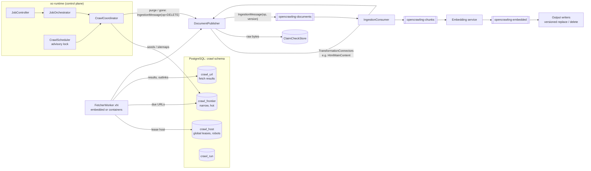
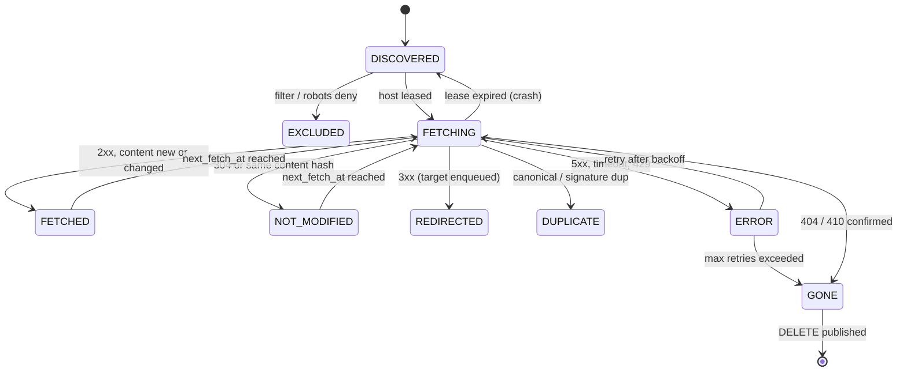

# Web Crawler Specification (`oc-web-repository-connector`)

| | |
|---|---|
| **Status** | Draft v3: aligned with issue #38 (see §1.3 and §18) |
| **Tracking issue** | [OpenCrawling/opencrawling#38](https://github.com/OpenCrawling/opencrawling/issues/38): Web Repository Connector |
| **Target release** | OpenCrawling 0.x: Phases 0 and 1a deliver issue #38; Phases 1b–3 follow |
| **Module** | `oc-web-repository-connector` (new), plus changes to `oc-core`, `oc-runtime` and the output-connector writers |
| **Date** | 2026-10-24 |

---

## 1. Purpose

OpenCrawling can ingest content from file systems, Alfresco, Iceberg, Flowable and Camunda, but it can't yet ingest from the web. This spec defines a web crawler that:

1. discovers and fetches HTML pages and linked binaries (PDF, DOCX and so on) from public sites and intranets,
2. feeds them into the existing claim-check, Kafka, Tika, chunking, embedding and vector-store pipeline through a single shared publishing path,
3. recrawls incrementally, so changed pages *replace* their previous chunks and pages that no longer exist are removed from the vector stores, with no stale or resurrected content,
4. behaves as a well-mannered crawler: robots.txt, crawl-delay, politeness per host enforced *across all jobs*, an identifiable user agent,
5. scales from one embedded process up to a horizontally scaled fleet of fetchers, using the same code in both modes.

### 1.1 Goals

- A `RepositoryConnector` that works with `JobOrchestrator`, the Admin UI and `connectors.json`.
- A durable crawl database (frontier, host leases, per-URL status) in PostgreSQL.
- Incremental recrawl using HTTP validators (`ETag`, `Last-Modified`) and content hashes.
- Correct update and delete semantics in every output connector: versioned writes, deterministic chunk IDs.
- Scoping rules that are expressive but safe: domains, path prefixes, regex, depth, URL budgets.
- Authenticated crawling for intranets, with access-control defaults that fail safe.
- Optional JavaScript rendering for single-page-app sites.
- First-class observability, plus measurable success criteria (§13).

### 1.2 Non-goals

- Internet-scale crawling with billions of URLs. The target is up to about 10 million URLs per job.
- A search-engine ranking signal (PageRank or similar).
- Bypassing CAPTCHAs, paywalls, bot detection or `robots.txt`. Ignoring robots is an explicit, audited, per-job admin override for sites the operator owns. It is never a default.
- Cross-job deduplication. The same URL crawled by two jobs is two documents (§6.1).
- Archiving (WARC output). This is a possible extension in Phase 3.

### 1.3 Relationship to issue #38

Issue #38, opened by Piergiorgio Lucidi, sets the agreed scope for the first deliverable. This spec keeps the issue's design (jsoup, `Flux<RepositoryDocument>`, virtual threads, rate limiting per host, testing against a mock server) and its setting names. It adds what's needed to run safely in production. Phases 0 and 1a (§15) deliver issue #38, and later phases are the roadmap beyond it.

| Issue #38 item | In this spec | Decision |
|---|---|---|
| Module `oc-web-repository-connector`, with `WebRepositoryConnector implements RepositoryConnector` | §16 | Kept |
| jsoup for HTML parsing and link extraction | §5.5 | Kept for parsing. Fetching uses Apache HttpClient 5 (§5.3), because `Jsoup.connect()` follows redirects without checking scope or SSRF on each hop, handles binaries and conditional requests poorly, and doesn't pool connections. |
| Seeds, max depth, delay, stay on domain, user agent, respect robots, max pages, include/exclude regex | §8.2 | Kept with the same names. They move from global Spring properties to the job's `crawlSpec`, so different jobs can crawl different sites. `spring.opencrawling.connector.web.*` still provides runtime-wide defaults. |
| `basePath` is the root seed | FR-1 | Kept |
| `connect()` sends HEAD to the first seed | FR-18 | Extended: falls back to GET on 405 or 501. One unreachable seed is a warning, not a failure. |
| Parsing robots.txt and scraping sitemaps | FR-2, FR-20 | Changed: crawler-commons instead of a hand-written parser. It implements RFC 9309 (including "5xx means disallow all"), `Crawl-delay` and sitemap indexes. |
| Thread-safe visited set and processing queue | §4.2 | Kept for Phase 1a as `InMemoryFrontier`. Phase 1b replaces it with the PostgreSQL frontier, for resume, incremental recrawl and deletes. |
| Virtual threads, `StructuredTaskScope`, token bucket per host | FR-21 to FR-23 | Kept, plus robots `Crawl-delay`, `Retry-After` and backoff per host |
| Document ID: SHA-256 or Base64 of the canonical URL | §6.1 | Narrowed to SHA-256. The hash also includes the job ID, so one job's purge can't delete another job's documents. |
| Content: the page's text or HTML | §5.5 | Changed: raw bytes go downstream, so Tika stays the only extraction path. Linked PDF and Office files are crawled too, subject to a MIME allowlist. |
| Metadata: headers, title, description, language, keywords, depth, referrer | §6.1 | Kept with the issue's key names (`web_depth`, `web_referrer`, `http_status`, `http_server`), plus `name`, which `JobOrchestrator` requires |
| Last modified from `Last-Modified` or `article:modified_time` | §6.1 | Kept |
| Tests: mock server, politeness, local static-site script | §14 | Kept and extended |
| JavaScript rendering added later | §5.7 | Kept, in Phase 3 |
| **Not in the issue** | §9, §11, §5.2 | Added as Phase 0 and 1a must-haves: no duplicate chunks on recrawl (§9.3), SSRF protection (§11), connector wiring (§9.1), URL normalization and canonical dedupe, response size and MIME limits, crawl-trap limits, safe regex matching (RE2/J), and turning off robots only as an audited admin override |

---

## 2. Current architecture: what the crawler plugs into

From the codebase as of branch `oc-qdrant-output-connector`:

| Concern | Today | Implication for the web crawler |
|---|---|---|
| Connector SPI | `RepositoryConnector.scan(String basePath) → Flux<RepositoryDocument>` (`oc-core`) | The crawler implements it for job integration, but the fetchers publish through the shared `DocumentPublisher` (§9.2). |
| Document model | `RepositoryDocument(id, uri, contentStream, metadata, acl, security, lastModified)` | The crawler must set `metadata["name"]` and `metadata["mimeType"]`. |
| Hand-off | Claim-check write and `IngestionMessage` publish happen inline in `JobOrchestrator.runJobInternal` | **Prerequisite:** extract this into `DocumentPublisher` so every producer shares one path (§9.2). |
| Chunk identity | `IngestionConsumer` assigns `UUID.randomUUID()` chunk IDs, and `VectorStoreWriterConsumer` only calls `add()` | **Prerequisite:** re-ingesting a changed document currently *appends* a second copy of its chunks. Deterministic chunk IDs and versioned replace are required (§9.3). |
| Deletes | None: `OutputConnector` only has `send()` | **Prerequisite:** deletes travel the same pipeline as upserts, with versions (§9.3). |
| Extraction | `IngestionConsumer` runs Tika and `TokenTextSplitter`, then deletes the claim check | The fetcher doesn't extract text. HTML cleanup is a `TransformationConnector` (§5.5). |
| Connector instantiation | `JobController.startJob` uses `className().contains("Alfresco")` and similar branches | **Prerequisite:** a factory SPI (§9.1). |
| Config | `connectors.json` (flat `Map<String,String>`), `jobs.json` (`JobDTO`) | The crawl definition is nested, so it gets a new `crawlSpec` field on `JobDTO` (§8). |
| Job control | `stop` and `pause` only update status in `jobs.json`. `ScanResult`s are collected into an unbounded `List`. Document counts use a `docCount += 10` placeholder. | **Prerequisite:** real cancellation, streaming counters and real counts (§9.4). |
| Telemetry | `IngestionConsumer` and `VectorStoreWriterConsumer` set `jobId = message.documentId()` | **Prerequisite:** carry the real `jobId` so crawl spans and errors are attributed to the right job (§9.4). |
| HTTP client | Alfresco uses `java.net.http.HttpClient` | Not suitable for the crawler: no per-client DNS resolver (needed for SSRF pinning), no NTLM. The crawler uses Apache HttpClient 5 (§5.3). |
| Infra | PostgreSQL+pgvector, Redis, Kafka KRaft, Ollama, Ozone (optional) | PostgreSQL holds the crawl DB and host leases. Kafka carries only fetched documents downstream, through the existing topics. |
| Concurrency | Virtual threads, `StructuredTaskScope`, `ObservabilityTask.observed(...)` | Each leased host runs as a virtual thread inside a structured scope. |

---

## 3. Lessons from existing open-source crawlers

| Crawler | What we adopt | What we avoid |
|---|---|---|
| **Apache ManifoldCF** (web connector) | A **version string** per document, so unchanged documents are skipped. **Seeding vs processing** as separate phases. **Hop-count** filters. Throttling per **bin** (host), shared across jobs. Session-based **login sequences**. Separate **authority connectors** for ACLs. End-of-job **"delete unreachable"** cleanup. | A heavy framework of agents and a custom DB schema per connector type. |
| **Elastic Open Crawler** | A declarative per-domain config: `seed_urls`, `sitemap_urls` and ordered **crawl rules** (first match wins). **Extraction rules**. **Purge crawls**. `max_crawl_depth`, `max_unique_url_count`. Full vs partial crawls. | Coupling to one sink (Elasticsearch). |
| **Lucidworks Fusion** web connector | **Restrict-to-tree** scoping. **Signature-based near-dedupe**. Per-site **JavaScript rendering**. Form/SAML auth. **Stray-content deletion**. | Closed configuration formats. |
| **Apache StormCrawler** | The **status index** as the source of truth. Per-host **politeness queues**. Pluggable **URL filters and normalizers** chained in order. An **adaptive scheduler** for `nextFetchDate`. **Metadata transfer** from parent to outlink. **crawler-commons** for robots.txt and sitemaps. | Storm itself, and a message-queue frontier (see below). |
| **Apache Nutch** (background) | URL normalization rules and trap heuristics. | Batch generate/fetch/update cycles on Hadoop. |

**Design decision: a PostgreSQL host-lease frontier, not a Kafka fetch queue.** StormCrawler partitions its fetch stream by host. Mapping that onto Kafka keys looks attractive but fails in practice for three reasons:

1. **Head-of-line blocking.** A partition carries many hosts and Kafka commits offsets in order, so one host with a 30 s crawl delay stalls every other host in its partition. Buffering out of order makes offset commits unsafe.
2. **Rebalancing** moves hosts between workers mid-crawl. That briefly breaks politeness and causes duplicate fetches.
3. **End-of-run detection** becomes a distributed-termination problem while URLs are still in flight in Kafka.

Instead, fetchers **lease a host** from PostgreSQL (`SELECT ... FOR UPDATE SKIP LOCKED`), crawl that host's due URLs while holding the lease, and release it. Politeness is then a property of the lease, a crashed worker's lease simply expires, and "run finished" is a query. Kafka is still used where it fits: carrying fetched documents into the existing pipeline.

---

## 4. Architecture

### 4.1 Logical components



| Component | Responsibility | Inspired by |
|---|---|---|
| `CrawlCoordinator` | Starts, pauses and cancels runs. Inserts seeds and expands sitemaps. Detects the end of a run (no due frontier rows and no active leases for the job). Runs the end-of-run purge. | ManifoldCF job lifecycle, Elastic purge crawl |
| `CrawlScheduler` | Fires cron-scheduled runs. Holds a PostgreSQL advisory lock so only one runtime instance starts a given run. | — |
| `HostLeaseManager` | Leases hosts that have due work for any running job, fairly, honoring `next_allowed_at` and suspensions. Renews and releases leases. | ManifoldCF bins |
| `FetcherWorker` | For each leased host: robots check, politeness delay, conditional GET, size and MIME limits, minimal HTML parse (links, canonical, directives), status write, hand-off to `DocumentPublisher` | StormCrawler `FetcherBolt` + parser |
| `StatusWriter` | Batched JDBC writes of fetch results and outlinks (after filter, normalize and dedupe). Computes `next_fetch_at`. In-process inside the fetcher, with no extra topic. | StormCrawler `StatusUpdaterBolt` + scheduler |
| `UrlPipeline` | An ordered chain of `UrlNormalizer` and `UrlFilter` steps | StormCrawler/Nutch |
| `RobotsCache` | robots.txt per host (RFC 9309), stored on the global `crawl_host` row | crawler-commons |
| `DocumentPublisher` (`oc-core`) | The single publishing path for all connectors: optional transformations, claim-check write, `IngestionMessage` with `operation` and `version` | Extracted from `JobOrchestrator` |
| `HtmlMainContentTransformer` | A `TransformationConnector` for boilerplate removal and extraction rules (§5.5) | Fusion, Elastic extraction rules |
| `WebRepositoryConnector` | The SPI entry point. `scan()` starts or attaches to a run and emits a progress `Flux` that completes when the run ends. | — |

### 4.2 Deployment modes

The crawler grows in three steps. Fetch, parse, filter and publish code is the same in all of them. Only the frontier and where the workers run change.

- **Phase 1a, in memory (issue #38).**
  - `WebRepositoryConnector.scan()` runs the crawl inside `oc-runtime` with an `InMemoryFrontier`: a concurrent visited set, plus a queue per host.
  - An in-process `HostRegistry` holds robots rules and token buckets. All jobs in the process share it, so two jobs on one host share that host's politeness budget.
  - State is lost on restart. Each run is a full crawl, capped by `maxPages`.
- **Phase 1b, persistent.**
  - `PostgresFrontier` and host leases (§4.3) replace the in-memory frontier behind the same `Frontier` interface. This adds resume, incremental recrawl and deletes.
  - Workers still run inside `oc-runtime` (`opencrawling.web.fetcher.workers`, default 8 leased hosts at a time).
- **Phase 2, decoupled.** The same worker runs in `docker/Dockerfile.web-fetcher` containers with `opencrawling.web.fetcher.enabled=true`. Embedded workers can be disabled with `workers=0`. Workers coordinate only through PostgreSQL leases, so scaling is just `deploy.replicas`.

Because publishing always goes through `DocumentPublisher`, metadata, transformations, claim-check naming and error handling are the same in both modes.

### 4.3 Host lease protocol (Phase 1b+)

1. **Acquire** (§7 query): a host that has due frontier rows for a `RUNNING` job, is not suspended, has `next_allowed_at ≤ now()`, and has no active lease. Set `leased_by = workerId` and `lease_until = now() + leaseDuration` (default 2 min).
2. **Work:** fetch up to `urlsPerLease` (default 50) due URLs for that host, across jobs, round-robin by job. Enforce the delay between requests. Renew the lease every `leaseDuration / 2`.
3. **Release:** clear the lease and write `next_allowed_at = lastRequest + delay`.
4. **Crash:** the lease expires, and frontier rows left in `FETCHING` with an expired lease are reset to their prior state on the next acquire.
5. **Fencing:** every write carries `lease_epoch`. Writes from a worker whose epoch is stale (because its lease expired and was re-acquired elsewhere) are rejected.

Because the lease is per **host** and global, two jobs crawling the same site share one politeness budget (FR-21).

### 4.4 Per-URL lifecycle



---

## 5. Functional requirements

### 5.1 Seeding and discovery

- **FR-1** Seeds: a list of absolute URLs (`crawlSpec.seeds`). For backwards compatibility, `JobDTO.path` may hold one seed or a newline-separated list.
- **FR-2** Sitemaps: an explicit `sitemapUrls`, plus discovery through `Sitemap:` lines in robots.txt (`discoverSitemaps`, default `true`). Supports XML sitemaps, sitemap indexes, gzip, RSS/Atom and text sitemaps, parsed with crawler-commons `SiteMapParser`. `<lastmod>` raises frontier priority.
- **FR-3** Link extraction from HTML: `a[href]`, `area[href]`, `link[rel=alternate|next|prev]`, `iframe[src]` and `frame[src]` (each type toggleable), honoring `<base href>`. Binaries aren't parsed for links.
- **FR-4** `rel="nofollow"` and `<meta name="robots" content="nofollow">` / `X-Robots-Tag: nofollow` suppress outlinks unless `respectNofollow=false`.
- **FR-5** Metadata is carried from parent to child: `web_depth`, `web_seed`, `web_referrer`, and an optional `web_anchor_text` capped at 10 values.

### 5.2 Scope and filtering (ordered chain)

Every candidate URL goes through `UrlPipeline` in this order. The first rejection stops evaluation, and the reason is recorded as `EXCLUDED:<filter>`.

1. **Normalize** (crawler-commons `BasicURLNormalizer` plus OpenCrawling rules): lowercase scheme and host, IDN to punycode, remove default ports, resolve `.`/`..`, remove fragment, percent-encoding normalization, sort query params (optional), strip configured params (`utm_*`, `fbclid`, `gclid`, `jsessionid`, `sid`, plus a user list), and an optional trailing-slash policy.
2. **Scheme filter**: `http` and `https` only.
3. **Scope filter**, one of:
   - `HOST` (exact hosts of the seeds),
   - `DOMAIN` (registrable domain via the public suffix list, so subdomains are included; the default),
   - `PREFIX` (restrict-to-tree: URL must start with a seed's directory),
   - `CUSTOM` (only `rules` decide).

   `stayOnDomain` (from issue #38) is an alias: `true`, the default, means `DOMAIN`, and `false` means `CUSTOM`.
4. **Crawl rules** (first match wins, then `defaultPolicy`):
   ```json
   { "policy": "deny",  "type": "contains", "pattern": "/calendar/" }
   { "policy": "allow", "type": "begins",   "pattern": "/docs/" }
   { "policy": "deny",  "type": "regex",    "pattern": ".*\\.(jpg|png|gif|css|js|woff2?)$" }
   ```
   `type ∈ {begins, ends, contains, regex}`, matched against the path plus query. Regexes run on RE2/J, which matches in linear time (§11).

   **Shorthand (issue #38, Phase 1a):** `includePatterns` and `excludePatterns` are regex lists that compile into rules:
   - each exclude pattern becomes a `deny` rule, and those are evaluated first,
   - each include pattern then becomes an `allow` rule,
   - `defaultPolicy` is `deny` when include patterns are given, and `allow` when there are none.

   A job uses either the shorthand or `rules`, not both. Ordered `rules` with `begins`, `ends` and `contains` arrive in Phase 1b.
5. **Depth filter**: `maxDepth` (seeds and sitemap entries have depth 0).
6. **Trap filter**: max URL length (default 2048), max path segment repetition (default 3), max query parameters (default 10), and a per-job, per-host URL budget `maxUrlsPerHost`.
7. **Budget filter**: `maxPages` (issue #38, default 1000) caps the pages fetched per run. `maxUrls` caps the frontier size (default 10 × `maxPages`).
8. **Robots filter**, applied at fetch time rather than discovery time.

### 5.3 Fetching

- **FR-10** HTTP/1.1 and HTTP/2 through **Apache HttpClient 5** (async client on virtual threads). It provides:
  - a custom `DnsResolver`, required for SSRF DNS pinning (§11),
  - a per-job `CookieStore`,
  - NTLM and SPNEGO for Phase 3 intranet auth,
  - connection-pool limits per route.

  `java.net.http.HttpClient` is rejected for this module because it can't resolve DNS per client or do NTLM. A `Fetcher` SPI allows the browser fetcher (§5.7).
- **FR-11** Conditional requests: send `If-None-Match` and `If-Modified-Since` from the stored `etag` and `last_modified`. A `304` sets the URL to `NOT_MODIFIED`, and nothing is published.
- **FR-12** Limits:
  - `maxContentBytes` (default 50 MiB), measured on **decoded** bytes. Larger responses are skipped, since a truncated HTML page or PDF is usually unusable. Reading stops at the limit, which also guards against decompression bombs.
  - `connectTimeout` (10 s), `readTimeout` (30 s), `maxRedirects` (5).
- **FR-13** MIME allowlist (`acceptMimeTypes`, default `text/html`, `application/xhtml+xml`, `text/plain`, `text/markdown`, `application/pdf`, OOXML/ODF). The type is detected from `Content-Type` and confirmed by Tika `detect()` on the first 8 KiB.
- **FR-14** Redirects are handled manually, so every hop goes through scope filtering and the SSRF check. Each hop is recorded as `REDIRECTED → target`, and the target is enqueued at the same depth.
- **FR-15** Compression: `Accept-Encoding: gzip, br`.
- **FR-16** User agent: a required, non-blank `userAgent` with a contact URL or email. `robotsAgentName` is configurable separately.
- **FR-17** Cookies: a per-job cookie store, never shared across jobs, even though leases and politeness are shared.
- **FR-18** `connect()` validates the configuration (§8.2), then checks the first seed with HEAD, falling back to GET on 405 or 501. An unreachable seed is logged as a warning and skipped. The job fails only if every seed is unreachable.

### 5.4 Politeness and robots

- **FR-20** RFC 9309 robots.txt via crawler-commons `SimpleRobotRulesParser`. It's cached on the **global** `crawl_host` row, fetched once per host for all jobs, with a TTL (default 24 h). Rules:
  - `2xx`: parse.
  - `4xx`: allow all.
  - `5xx` or unreachable: disallow all, with backoff.
  - Redirects: follow up to 5.

  If jobs use different `robotsAgentName` values, the rules are evaluated per agent against the same cached file.
- **FR-21** Politeness is **per host, across all jobs**. The delay is `max(crawlDelay from robots, the largest delayMs of any running job targeting the host)`, capped by `maxCrawlDelay` (default 30 s; hosts over the cap are skipped and reported). Only one worker fetches from a given host at a time: in Phase 1a that's the host's in-process queue, and from Phase 1b it's the lease holder (§4.3).
- **FR-22** Per-host concurrency: one lease, and up to `maxConnectionsPerHost` requests in flight (default 1; values above 1 are an admin override for operator-owned sites).
- **FR-23** Adaptive backoff: honor `Retry-After` on `429` or `503`, and otherwise back off exponentially on the host row. `hostErrorThreshold` (default 20) consecutive errors set `suspended_until` for all jobs.
- **FR-24** Page directives: `<meta name="robots">` and `X-Robots-Tag` with `noindex` (follow links, don't publish, publish `DELETE` if previously indexed), `nofollow` and `none`.
- **FR-25** `respectRobots` (issue #38) defaults to `true`. Setting it to `false` is an admin-only per-job override. It's logged at WARN on every run start, recorded in `crawl_run` from Phase 1b, and never applied to hosts outside that job's seeds.

### 5.5 Content processing

The fetcher parses minimally. Full text extraction stays in `IngestionConsumer` (Tika).

**In the fetcher** (jsoup, HTML only):

| Field | Source | Metadata key |
|---|---|---|
| Title | `<title>`, falling back to `og:title` | `title` |
| Description | `meta[name=description]`, `og:description` | `description` |
| Language | `html[lang]`, `Content-Language` | `language` |
| Keywords | `meta[name=keywords]` | `keywords` |
| Modified time | `meta[property=article:modified_time]` | fallback for `lastModified` (§6.1) |
| Canonical | `link[rel=canonical]` (same-scope only) | `web_canonical_url` |
| Outlinks | §5.1 FR-3 | — (to `StatusWriter`) |
| Robots directives | §5.4 FR-24 | — |

**In `HtmlMainContentTransformer`** (a `TransformationConnector` shipped in the module, applied by `DocumentPublisher`, configured by `crawlSpec.content`):

- **FR-30 Main-content mode** (`content.mode`):
  - `raw` (default): send the original bytes and let Tika handle them.
  - `main`: strip `nav`, `header`, `footer`, `aside`, `script`, `style` and `excludeSelectors`, or keep only `includeSelectors`, then emit cleaned HTML.
- **FR-31 Extraction rules** (Phase 2): a CSS selector or XPath maps to a metadata field `x_<field>`.

Keeping these in a transformation means they can be reused by other connectors (Alfresco HTML content, for example), tested in isolation, and changed without touching fetch logic.

**Canonicalization and dedupe:**

- **FR-32** If the canonical URL differs from the fetched URL and is in scope, the page is marked `DUPLICATE` of the canonical, the canonical is enqueued, and nothing is published. If a previously published URL becomes a duplicate, or its canonical changes, a `DELETE` for the old document ID is published (§5.10).
- **FR-33** Exact dedupe: SHA-256 of the normalized text body, within the job.
- **FR-34** Near-dedupe (Phase 2, `nearDuplicateThreshold`, default off): 64-bit SimHash with Hamming distance ≤ 3.
- **FR-35** Change detection: if `content_hash` is unchanged, the URL becomes `NOT_MODIFIED` even on a `200`.

### 5.6 Recrawl and scheduling

- **FR-40** Crawl types:
  - `FULL`: reseed, revisit every known URL, then purge anything not seen (§5.10).
  - `INCREMENTAL` (default for scheduled runs): due URLs and new discoveries only, with no purge.
  - `SITEMAP_ONLY` (Phase 2): refresh from sitemaps' `<lastmod>`.
- **FR-41** Adaptive intervals:
  - Changed: `interval = max(minInterval, interval / 2)`.
  - Unchanged: `interval = min(maxInterval, interval × 1.5)`.
  - Defaults: `defaultInterval` 1 d, `minInterval` 1 h, `maxInterval` 30 d.
  - Errors: `errorInterval` 1 h × attempt.
  - `GONE`: never.
  - Per-rule overrides are allowed.
- **FR-42** Cron schedules on the job (`crawlSpec.schedule`). `CrawlScheduler` polls every minute and starts a run only after taking `pg_try_advisory_xact_lock(hash(jobId))` and confirming no `RUNNING` run exists for the job. That makes it safe with any number of runtime instances.
- **FR-43** Resumability: state is in PostgreSQL. A restarted or paused run resumes from frontier rows, and expired leases are recovered (§4.3).
- **FR-44** Spec versioning: each run stores `spec_hash` (SHA-256 of the canonical JSON of `crawlSpec`). If it differs from the previous run's, the coordinator re-evaluates scope and rules over existing URLs at run start. Newly excluded URLs become `EXCLUDED` and are deleted on the next `FULL` run, subject to the purge safety ratio.

### 5.7 JavaScript rendering (Phase 3)

- **FR-50** `Fetcher` SPI:
  ```java
  public sealed interface Fetcher permits HttpFetcher, BrowserFetcher {
      FetchResult fetch(FetchRequest request) throws InterruptedException;
  }
  ```
- **FR-51** `BrowserFetcher` uses Playwright for Java (headless Chromium), enabled per rule or host (`render: true`). It waits for `networkidle` or a selector, then serializes the DOM. Robots, politeness and SSRF checks apply the same way, and all browser traffic goes through an SSRF-enforcing proxy. It runs in `Dockerfile.web-fetcher-browser`.

### 5.8 Authentication (intranet crawling)

Auth configurations are bound to URL prefixes:

| Type | Config | Notes |
|---|---|---|
| `basic` | `username`, `passwordRef` | Sent only to matching prefixes and only over HTTPS unless `allowInsecureAuth`. |
| `bearer` | `tokenRef` | Static or refreshed from an OAuth2 client-credentials endpoint. |
| `header` | `name`, `valueRef` | API gateways. |
| `cookie` | `name`, `valueRef`, `domain` | Pre-issued session cookie. |
| `form` | `loginUrl`, `fields`, `usernameRef`, `passwordRef`, `successSelector` or `successUrlRegex` | Login sequence. Re-runs on 401/403 or when a login page is detected. |
| `ntlm` / `spnego` (Phase 3) | — | Apache HttpClient 5 auth schemes. |

Secrets are never stored in plain text in `connectors.json` or `jobs.json`. A `*Ref` resolves through Spring `Environment` or a secrets provider (`env:…`, `vault:…`).

### 5.9 Security and ACL mapping

`SecurityConfig` is produced per job by `aclMode`:

- `public`: `SecurityConfig.createPublic()`, `acl = "public"`.
- `static`: a list of `PermissionRule`s applied to all documents of the job.
- `byRule`: per crawl-rule ACL override (for example `/hr/` → `group:hr`).
- `authority` (Phase 3): delegate to the job's `authorityConnector`.

**Fail-safe default:**

- `aclMode` is **required** when `crawlSpec.auth` is non-empty, or when any seed resolves to a private network address.
- In those cases `public` is rejected unless `confirmPublicExposure: true` is set, and that setting is audited in `crawl_run`.
- Without auth and with only public-internet seeds, `aclMode` defaults to `public`.

`acl` (the legacy flat string) and `security` must stay consistent, so the pgvector pre-filter and the `SecurityConfig` re-check in `McpVectorServer` agree.

### 5.10 Deletion and update propagation

Every change to a document goes through the **same pipeline**, keyed by `documentId`, as an `IngestionMessage` with an `operation` and a monotonic `version` (§6.2). Writers apply a message only if its version is at least the latest version they have for that document (§9.3). This prevents a delayed upsert from bringing back a deleted document, and a delete from overtaking an earlier upsert.

- **FR-60** `DELETE` is published when:
  - a URL turns `GONE` (404/410 after `goneConfirmations`, default 2),
  - a page carries `noindex`,
  - a page becomes a duplicate, or its canonical changes (FR-32),
  - a URL becomes out of scope after a spec change (FR-44), applied on the next `FULL` run.
- **FR-61** End of a `FULL` run: every URL with `last_seen_run < current_run` gets a `DELETE`. The purge is skipped if the run aborted, or if more than `purgeSafetyRatio` (default 0.5) of known URLs would be deleted, which protects against a site outage. Skipped purges are reported through `TelemetryTraceStore`.
- **FR-62** Update: a `FETCHED` page with changed content publishes `UPSERT` with a new version. The writer replaces all chunks of the document (§9.3), so pages that shrink leave no stale chunks.

---

## 6. Data contracts

### 6.1 `RepositoryDocument` and document identity

```java
new RepositoryDocument(
    WebIds.documentId(jobId, canonicalUrl), // "web:" + hex(sha256(jobId + "\n" + canonicalUrl))
    canonicalUrl,
    bodyStream,
    metadata,
    acl,
    securityConfig,
    lastModified                            // Last-Modified header, else <meta property="article:modified_time">, else fetch time
);
```

**Identity decision:** the document ID includes `jobId`, so the same URL in two jobs is two documents. That's deliberate:

- jobs are the unit of ownership, ACL (`aclMode` differs per job), schedule and purge,
- a shared ID would let one job's purge delete another job's content.

Cross-job dedupe is a non-goal. When a page's canonical URL changes, its ID changes too, and FR-32 publishes a `DELETE` for the old ID.

Key names follow issue #38. Keys that every connector shares are camelCase (`name`, `mimeType`, `title`). Crawler-specific keys are snake_case, with a `web_` or `http_` prefix.

| Metadata key | Example | Required |
|---|---|---|
| `name` | `features.html`, from the last path segment, or `index.html` | yes (`JobOrchestrator` uses it to name the claim-check file) |
| `mimeType` | `text/html` | yes |
| `source` | `web` | yes (provenance, §11) |
| `jobId` | `7` | yes (telemetry, §9.4) |
| `title`, `description`, `language`, `keywords` | `Core Ingestion Features - OpenCrawling` | if present |
| `http_status`, `http_server`, `http_etag`, `http_last_modified`, `http_content_length` | `200`, `Cloudflare` | `http_status` always; the rest if present |
| `web_host`, `web_canonical_url` | `docs.opencrawling.org` | yes |
| `web_depth`, `web_referrer`, `web_seed` | `2`, `https://docs.opencrawling.org/intro` | yes (seeds have no `web_referrer`) |
| `web_anchor_text` | up to 10 values | optional |
| `web_content_hash`, `web_fetched_at`, `web_crawl_run_id` | SHA-256 hex, ISO-8601, UUID | yes (`web_crawl_run_id` from Phase 1b) |
| `x_*` | extraction-rule output | optional (Phase 2) |

### 6.2 Message changes (`oc-core/messaging`)

No new topics. The three existing messages each gain fields, and every message is keyed by `documentId` on every topic, so per-document ordering is preserved hop by hop:

```java
public enum DocumentOperation { UPSERT, DELETE }

public record IngestionMessage(
    String documentId, String uri, Map<String, List<String>> metadata,
    String acl, SecurityConfig security, String lastModified,
    String transformationConnector, String transformationEngine, Map<String, String> transformationConfig,
    String jobId,                    // new: real job id for telemetry
    DocumentOperation operation,     // new: default UPSERT
    long version                     // new: monotonic per document, epoch millis of fetchedAt
) { /* existing convenience constructors keep defaults: jobId=null, UPSERT, version=lastModified millis */ }
```

`DocumentChunkMessage` and `DocumentEmbeddedMessage` gain `jobId`, `operation`, `version`, `chunkIndex` and `chunkCount`. For `DELETE`, `IngestionConsumer` skips extraction and forwards a single message with `chunkIndex = -1`. The embedding service forwards it without embedding.

Chunk IDs are deterministic: `chunkId = documentId + "#" + version + "#" + chunkIndex` (§9.3).

Fetcher-internal records (`FetchRequest`, `FetchResult`, `Outlink`, `CrawlStatus`) live in the web module and aren't messages:

```java
public enum CrawlStatus { DISCOVERED, FETCHING, FETCHED, NOT_MODIFIED, REDIRECTED, DUPLICATE, EXCLUDED, ERROR, GONE }
```

---

## 7. Crawl database (PostgreSQL, schema `crawl`)

Managed by Flyway in the web module with its **own history table** (`flyway.table=flyway_crawl_history`, `schemas=crawl`), so it can't collide with other modules' migrations. It's configured through `opencrawling.web.datasource.*` and defaults to the main datasource (see open question 1).

The frequently updated scheduling state is split from the wide fetch-result rows to limit write amplification and table bloat:

```sql
CREATE TABLE crawl.crawl_run (
  run_id        UUID PRIMARY KEY,
  job_id        TEXT NOT NULL,
  crawl_type    TEXT NOT NULL,             -- FULL | INCREMENTAL | SITEMAP_ONLY
  status        TEXT NOT NULL,             -- RUNNING | PAUSED | COMPLETED | ABORTED | FAILED
  spec_hash     BYTEA NOT NULL,            -- FR-44
  started_at    TIMESTAMPTZ NOT NULL,
  finished_at   TIMESTAMPTZ,
  respect_robots BOOLEAN NOT NULL DEFAULT TRUE,
  audit         JSONB NOT NULL DEFAULT '{}', -- overrides: respectRobots=false, confirmPublicExposure, ...
  stats         JSONB NOT NULL DEFAULT '{}'
);

-- Global per host: shared by all jobs (politeness, robots, leases)
CREATE TABLE crawl.crawl_host (
  host_key           TEXT PRIMARY KEY,
  robots_txt         TEXT,
  robots_fetched_at  TIMESTAMPTZ,
  robots_status      INT,
  crawl_delay_ms     INT,
  next_allowed_at    TIMESTAMPTZ,
  consecutive_errors INT NOT NULL DEFAULT 0,
  suspended_until    TIMESTAMPTZ,
  leased_by          TEXT,
  lease_until        TIMESTAMPTZ,
  lease_epoch        BIGINT NOT NULL DEFAULT 0
) WITH (fillfactor = 70);

-- Per job per host: budgets and counters
CREATE TABLE crawl.crawl_job_host (
  job_id    TEXT NOT NULL,
  host_key  TEXT NOT NULL REFERENCES crawl.crawl_host,
  url_count BIGINT NOT NULL DEFAULT 0,
  due_count BIGINT NOT NULL DEFAULT 0,    -- maintained by StatusWriter, used for lease selection
  PRIMARY KEY (job_id, host_key)
) WITH (fillfactor = 70);

-- Narrow, hot: updated on every fetch
CREATE TABLE crawl.crawl_frontier (
  job_id        TEXT        NOT NULL,
  url_hash      BYTEA       NOT NULL,     -- sha256(normalized url)
  host_key      TEXT        NOT NULL,
  status        TEXT        NOT NULL,
  depth         SMALLINT    NOT NULL,
  priority      REAL        NOT NULL DEFAULT 0,
  next_fetch_at TIMESTAMPTZ,
  lease_epoch   BIGINT,
  PRIMARY KEY (job_id, url_hash)
) WITH (fillfactor = 70);
CREATE INDEX crawl_frontier_due ON crawl.crawl_frontier (host_key, next_fetch_at)
  WHERE status IN ('DISCOVERED','FETCHED','NOT_MODIFIED','ERROR');

-- Wide: written only when the fetch result changes
CREATE TABLE crawl.crawl_url (
  job_id          TEXT        NOT NULL,
  url_hash        BYTEA       NOT NULL,
  url             TEXT        NOT NULL,
  document_id     TEXT        NOT NULL,
  discovered_at   TIMESTAMPTZ NOT NULL,
  last_fetched_at TIMESTAMPTZ,
  last_seen_run   UUID,
  fetch_interval  INTERVAL,
  http_status     INT,
  etag            TEXT,
  last_modified   TEXT,
  content_hash    BYTEA,
  simhash         BIGINT,
  canonical_hash  BYTEA,
  published_version BIGINT,              -- last version sent downstream, null if never or deleted
  redirect_target TEXT,
  fail_count      INT         NOT NULL DEFAULT 0,
  excluded_reason TEXT,
  metadata        JSONB,
  PRIMARY KEY (job_id, url_hash)
);
CREATE INDEX crawl_url_hash  ON crawl.crawl_url (job_id, content_hash);
CREATE INDEX crawl_url_purge ON crawl.crawl_url (job_id, last_seen_run);
```

**Vacuum tuning** for `crawl_frontier` and `crawl_host`:

```sql
ALTER TABLE crawl.crawl_frontier SET (autovacuum_vacuum_scale_factor = 0.02, autovacuum_analyze_scale_factor = 0.01);
```

`last_seen_run` is updated on every visit, so updates to `crawl_url` are batched (500 rows) and skipped when nothing else changed except `last_seen_run`. In that case the run ID is recorded in bulk at end of run with one `UPDATE ... FROM (VALUES ...)` per batch of visited hashes.

**Host lease query:**

```sql
UPDATE crawl.crawl_host h
SET leased_by = :worker, lease_until = now() + :leaseDuration, lease_epoch = h.lease_epoch + 1
WHERE h.host_key = (
  SELECT h2.host_key FROM crawl.crawl_host h2
  JOIN crawl.crawl_job_host jh ON jh.host_key = h2.host_key AND jh.due_count > 0
  JOIN crawl.crawl_run r ON r.job_id = jh.job_id AND r.status = 'RUNNING'
  WHERE (h2.lease_until IS NULL OR h2.lease_until < now())
    AND (h2.next_allowed_at IS NULL OR h2.next_allowed_at <= now())
    AND (h2.suspended_until IS NULL OR h2.suspended_until < now())
  ORDER BY h2.next_allowed_at NULLS FIRST
  LIMIT 1
  FOR UPDATE OF h2 SKIP LOCKED)
RETURNING h.host_key, h.lease_epoch;
```

Outlinks are inserted with `INSERT ... ON CONFLICT DO NOTHING` in batches. All writes carry the lease epoch (fencing, §4.3).

**Sizing.** About 1 KB per URL across both tables means 10 M URLs come to roughly 10 GB per job. Partition `crawl_frontier` and `crawl_url` by `job_id` (`LIST`) once there are more than 20 jobs.

---

## 8. Configuration

### 8.1 Connector (`connectors.json`): shared HTTP identity

```json
{
  "name": "Web_Crawler",
  "description": "HTTP(S) web crawler",
  "type": "repository",
  "className": "org.opencrawling.web.WebRepositoryConnector",
  "maxConnections": 10,
  "configuration": {
    "userAgent": "OpenCrawlingBot/1.0 (+https://opencrawling.github.io/bot)",
    "robotsAgentName": "OpenCrawlingBot",
    "connectTimeoutMs": "10000",
    "readTimeoutMs": "30000",
    "maxContentBytes": "52428800",
    "allowPrivateNetworks": "false",
    "privateAllowlist": "",
    "proxyUrl": ""
  }
}
```

You can set runtime-wide defaults for every job setting with the issue #38 property names under `spring.opencrawling.connector.web.*`, for example `spring.opencrawling.connector.web.max-depth=3`. A job's `crawlSpec` overrides them.

Worker counts are deployment properties (`opencrawling.web.fetcher.*`), not connector config.

### 8.2 Job (`jobs.json`): new nullable `crawlSpec` on `JobDTO`

The Phase 1a settings are exactly the parameters from issue #38:

| Setting | Default | Notes |
|---|---|---|
| `seeds` | required | Falls back to `JobDTO.path` |
| `maxDepth` | `3` | Seeds have depth 0 |
| `delayMs` | `1000` | Minimum delay per host. Robots `Crawl-delay` can raise it (FR-21). |
| `stayOnDomain` | `true` | Alias for `scope` (§5.2) |
| `userAgent` | from the connector | Must include a contact URL or email (FR-16) |
| `respectRobots` | `true` | `false` is an audited admin override (FR-25) |
| `maxPages` | `1000` | Pages fetched per run |
| `includePatterns`, `excludePatterns` | `[]` | Shorthand for crawl rules (§5.2) |
| `aclMode` | `public` | Required in some cases (§5.9). Not in the issue. |

A minimal Phase 1a job:

```json
"crawlSpec": {
  "seeds": ["https://docs.opencrawling.org/"],
  "maxDepth": 3,
  "delayMs": 1000,
  "stayOnDomain": true,
  "respectRobots": true,
  "maxPages": 1000,
  "includePatterns": ["^/docs/.*"],
  "excludePatterns": [".*\\.(png|jpe?g|gif|svg|css|js)$"],
  "aclMode": "public"
}
```

A full example with settings from later phases:

```json
{
  "id": "7",
  "name": "Product docs",
  "repositoryConnector": "Web_Crawler",
  "outputConnector": "PGVector",
  "path": "https://docs.example.com/",
  "crawlSpec": {
    "seeds": ["https://docs.example.com/"],
    "sitemapUrls": ["https://docs.example.com/sitemap.xml"],
    "discoverSitemaps": true,
    "scope": "DOMAIN",
    "maxDepth": 6,
    "maxPages": 200000,
    "maxUrlsPerHost": 100000,
    "defaultPolicy": "allow",
    "rules": [
      { "policy": "deny",  "type": "regex",    "pattern": ".*\\.(png|jpe?g|gif|svg|css|js|woff2?)$" },
      { "policy": "deny",  "type": "contains", "pattern": "/search?" },
      { "policy": "allow", "type": "begins",   "pattern": "/api/", "recrawlInterval": "PT6H" }
    ],
    "stripQueryParams": ["utm_*", "ref"],
    "content": {
      "mode": "main",
      "includeSelectors": ["main", "article"],
      "excludeSelectors": [".cookie-banner", "#feedback"],
      "extractionRules": [ { "field": "product", "selector": "meta[name=product]", "attr": "content" } ]
    },
    "delayMs": 1000,
    "politeness": { "maxCrawlDelayMs": 30000, "maxConnectionsPerHost": 1 },
    "schedule": { "cron": "0 0 2 * * *", "crawlType": "INCREMENTAL", "fullEvery": "P7D" },
    "nearDuplicateThreshold": 3,
    "aclMode": "public",
    "auth": []
  }
}
```

Validation runs on `POST /api/jobs`. It rejects:

- regexes that RE2/J can't compile,
- unknown enums, `maxDepth > 50`, an empty `userAgent`,
- seeds outside the declared scope,
- a missing or unconfirmed `aclMode` under the conditions in §5.9.

### 8.3 Admin UI (`oc-admin-ui`)

- **Phase 1a:** `ConnectorForm.tsx` gets a "Web Crawler" type, and the job form gets the issue #38 settings (§8.2).
- **Phase 1b:**
  - The job editor gets a "Crawl" tab with seeds, sitemaps, scope, a rules table that can be reordered (first match wins), politeness, schedule and auth (references only). An ACL selector enforces §5.9.
  - The job detail page shows a crawl panel: counts by status, top hosts (from `/api/crawl/{jobId}/stats`, not from metrics), recent errors, and the skipped-purge warning.
- **Phase 2:**
  - **URL tester** (`POST /api/crawl/test-url`): normalized URL, matching rule, robots decision, depth.
  - "Recrawl URL" action.
  - Extraction-rule editor.

### 8.4 REST additions (`/api/crawl`)

| Method | Path | Purpose | Phase |
|---|---|---|---|
| `GET` | `/api/crawl/{jobId}/stats` | Counts by status and run, top-N hosts with queued, fetched, errors and delay | 1b |
| `GET` | `/api/crawl/{jobId}/urls?status=&host=&q=` | Paged browse of the crawl DB | 1b |
| `DELETE` | `/api/crawl/{jobId}` | Wipe the crawl DB for a job (with confirm), publishing `DELETE` for every published document | 1b |
| `POST` | `/api/crawl/{jobId}/urls` | Inject URLs (manual seed or recrawl) | 2 |
| `POST` | `/api/crawl/test-url` | Rule and robots dry run | 2 |

---

## 9. Required changes outside the new module (Phase 0)

### 9.1 Connector factory SPI (`oc-core`)

```java
public interface RepositoryConnectorFactory {
    String className();                                   // matches ConnectorDTO.className
    RepositoryConnector create(Map<String, String> configuration, JobContext job);
}
```

It's discovered through `ServiceLoader`, the mechanism `ConnectorController` already uses for listing, and replaces the `className().contains(...)` chain in `JobController.startJob`. `JobContext` carries `jobId`, `path` and `crawlSpec`. Existing connectors get trivial factories.

### 9.2 `DocumentPublisher` (`oc-core`)

The claim-check and publish block in `JobOrchestrator.runJobInternal` moves into:

```java
public interface DocumentPublisher {
    /** Applies transformations, writes the claim check, publishes UPSERT. Blocks until Kafka acks. */
    PublishResult upsert(RepositoryDocument doc, PublishContext ctx);
    /** Publishes DELETE through the same topic and key. */
    PublishResult delete(String documentId, String uri, long version, PublishContext ctx);
}
```

`PublishContext` carries `jobId`, transformation connector settings, narrativization (the existing `MustacheTransformationConnector`) and `HtmlMainContentTransformer` config. `JobOrchestrator` and `FetcherWorker` both call it, and no other code writes to `opencrawling-documents`.

### 9.3 Versioned replace and delete in writers

These rules apply to `VectorStoreWriterConsumer` and the Milvus, OpenSearch2, OpenSearch3 and Qdrant writers:

1. **Deterministic chunk IDs:** `IngestionConsumer` sets `chunkId = documentId#version#chunkIndex` and stops using random UUIDs.
2. **Version gate:** each writer keeps a per-document watermark (pgvector: a `crawl_doc_version(document_id, version, deleted)` side table in the output DB; other stores: a doc-level marker record or payload field). A message whose `version` is below the watermark is dropped.
3. **Replace:**
   - Write the new version's chunks first. Upserting by deterministic ID makes retries idempotent.
   - When the chunk with `chunkIndex == chunkCount - 1` has been written, delete every chunk of the document whose `version` is older than the new one: `Filter.Expression` `documentId == X && version < V`.
   - Readers can briefly see two versions during this window, which is acceptable. They never see zero.
4. **Delete:** remove every chunk of the document and set the watermark with `deleted = true`, so a delayed older `UPSERT` can't bring it back.
5. **Interface:**
   - `OutputConnector` gains `default Mono<Void> delete(String documentId, long version) { return Mono.empty(); }`.
   - A shared contract test (`OutputConnectorVersioningContract`) must pass for each writer before web jobs can target it. pgvector passes in Phase 0; Milvus, OpenSearch and Qdrant pass in Phase 1b.

Other connectors benefit immediately: re-scanning an Alfresco folder stops duplicating chunks.

### 9.4 Job lifecycle and telemetry

- `JobController.stop/pause` signal the running crawl through a `JobRegistry` (`jobId → JobHandle` with cancel, pause and resume). For web jobs this sets `crawl_run.status`, and workers stop leasing hosts for that job.
- `JobOrchestrator` replaces the in-memory `List<ScanResult>` with streaming counters (`LongAdder` per result type).
- `JobController.updateJobStatus` drops the `docCount += 10` placeholder and reads real counts (from `crawl_run.stats` for web jobs).
- `IngestionConsumer` and `VectorStoreWriterConsumer` take `jobId` from the message instead of `documentId`, so spans and errors are attributed to the right job.
- A new stage, `"Crawling"`, is added to the `JobController` stage switch and to `TelemetryTraceStore` spans.

### 9.5 Docker

- `docker/Dockerfile.web-fetcher` (Phase 2) and `Dockerfile.web-fetcher-browser` (Phase 3).
- The new module is added to the explicit module `COPY` lists in all Dockerfiles.
- A `docker-compose-decoupled.yml` service `oc-web-fetcher` with `deploy.replicas`.

---

## 10. Non-functional requirements

Politeness, not hardware, usually bounds crawl time. Throughput targets are therefore stated per number of hosts:

**Estimated run time ≈ max( N_pages / R_fleet , max over hosts of (pages_h × delay_h) )**, where `R_fleet` is the fleet fetch rate when not politeness-bound.

| Example | Calculation | Result |
|---|---|---|
| One site, 200k pages, 1 s delay | 200,000 × 1 s | about 55 h, regardless of fleet size |
| 500 sites × 400 pages, 1 s delay, 4 fetchers | politeness term 400 s; fleet term 200,000 / 300 ≈ 11 min | about 11 min |

The Admin UI shows this estimate for a job before its first run, using sitemap counts when available.

| ID | Requirement | Target |
|---|---|---|
| NFR-1 | Embedded throughput, single node, ≥ 50 distinct hosts with 1 s delay | ≥ 50 pages/s aggregate |
| NFR-2 | Decoupled throughput, 4 fetcher replicas, ≥ 300 distinct hosts with 1 s delay | ≥ 300 pages/s aggregate (linear in replicas while hosts ≥ 1.2 × target rate) |
| NFR-3 | Politeness accuracy, across all jobs and workers | No two requests to one host closer than the effective delay (−5 % jitter tolerance), including during worker crashes and lease handover |
| NFR-4 | Memory | Fetcher heap independent of crawl size |
| NFR-5 | Durability | Killing any process loses at most in-flight fetches. The run resumes without re-fetching completed URLs. |
| NFR-6 | Incremental efficiency | An unchanged-site recrawl publishes 0 `IngestionMessage`s |
| NFR-7 | Scale | 10 M URLs per job, 1,000 hosts per job, 50 concurrent jobs |
| NFR-8 | Lease overhead | Lease acquire p99 < 50 ms at 100 workers |
| NFR-9 | Java | Java 25 with `--enable-preview`, consistent with the rest of the build |

---

## 11. Security requirements

- **SSRF protection (critical).**
  - A custom HttpClient 5 `DnsResolver` resolves each host and rejects loopback, link-local (including `169.254.169.254`), RFC 1918, CGNAT (`100.64/10`), ULA and multicast addresses, unless `allowPrivateNetworks=true` *and* the host matches `privateAllowlist`.
  - The resolved address is pinned for the connection, which blocks DNS rebinding.
  - Every redirect hop is checked again.
  - The browser fetcher goes through an enforcing proxy (FR-51).
- **ReDoS.** All user patterns use RE2/J (linear-time matching).
- **Decompression bombs.** Enforce limits on decoded size and on the decompression ratio (FR-12).
- **Secrets.** Only `*Ref` indirection (§5.8). Secrets are redacted in logs, spans and `/api/connectors` responses.
- **TLS.** Verification is on by default. `trustAllCertificates` is per-connector, admin-only and audited.
- **ACL defaults that fail safe** (§5.9). Authenticated or private-network crawls can't silently become public.
- **Prompt injection and provenance.** Crawled web text reaches LLMs through MCP. Every chunk carries `source=web`, `web_host` and the page URI.
  - `secureVectorSearch` returns `source` and `web_host` in results, so MCP clients and agent policies can treat web content as untrusted.
  - An optional per-job `trustLevel` (`untrusted` by default for web) is stored as metadata for downstream filtering.
- **Stored content** is untrusted. HTML is never rendered in the Admin UI without sanitization.

---

## 12. Observability

- **Spans:** `crawl.run`, `crawl.lease` (attribute: `host`), `crawl.fetch` (attributes: `url.host`, `http.status_code`, `bytes`, `cache=hit|304|miss`) and `crawl.publish`. They're all attributed with the real `jobId` (§9.4) and propagate downstream through Kafka headers.
- **Micrometer metrics.** Labels are bounded: there's **no host label**, so the label set doesn't grow with the number of hosts.
  - `oc_crawl_fetch_total{job_id,status_class}`, where `status_class ∈ 2xx|304|3xx|4xx|5xx|error`
  - `oc_crawl_fetch_latency_seconds{job_id}`
  - `oc_crawl_bytes_total{job_id}`
  - `oc_crawl_frontier_size{job_id,status}`
  - `oc_crawl_leases_active`, `oc_crawl_lease_acquire_seconds`
  - `oc_crawl_robots_denied_total{job_id}`
  - `oc_crawl_hosts_suspended`
  - `oc_crawl_published_total{job_id,operation}`
  - `oc_crawl_purge_skipped_total{job_id}`

  `job_id` is bounded by the number of configured jobs. Per-host detail comes from `/api/crawl/{jobId}/stats`, backed by the crawl DB.
- **TelemetryTraceStore:** `recordError(jobId, ..., "WebCrawler", ...)` for host suspensions, robots failures, auth failures and skipped purges. These feed the AI-assisted RCA in the Admin UI.
- **Logs:** one INFO line per run summary. Per-URL logs stay at DEBUG.

---

## 13. Success metrics

These metrics measure whether the crawler delivers good RAG content. They aren't just about the crawler running. They're computed from the crawl DB, Prometheus and a retrieval-evaluation script, and reported per job in the crawl panel and in the release checklist.

| Metric | Definition | Target | How it's measured |
|---|---|---|---|
| **Coverage** | In-scope URLs indexed ÷ in-scope URLs known (sitemap entries plus discovered, excluding `EXCLUDED`/`DUPLICATE`/`GONE`) | ≥ 95 % | Crawl DB query, at the end of a `FULL` run |
| **Freshness lag** | p95 time from a page change (sitemap `<lastmod>`, or detection by hash) to its chunks being written | ≤ 2 × effective recrawl interval; ≤ 24 h at defaults | `crawl_url.last_fetched_at` vs `<lastmod>`, plus writer span timestamps |
| **Deletion lag** | p95 time from a confirmed `GONE` to all chunks removed | ≤ 1 h after confirmation | `GONE` timestamp vs writer delete span |
| **Stale chunk count** | Chunks whose `version` is below their document's watermark, after the pipeline settles | 0 | Nightly check query per output store |
| **Resurrection count** | Documents present in the store but `GONE` or `EXCLUDED` in the crawl DB | 0 | Nightly reconciliation job |
| **Duplicate rate** | Published documents that are an exact or near duplicate of another document in the same job | ≤ 2 % | `content_hash`/`simhash` grouping |
| **Conditional efficiency** | (304 + same-hash) ÷ fetches on an incremental run of an unchanged site | ≥ 90 %, with 0 messages published | `oc_crawl_fetch_total`, `oc_crawl_published_total` |
| **Crawl error rate** | Fetches ending in `5xx`, timeout or connection error ÷ all fetches (404/410 excluded) | ≤ 2 % | `oc_crawl_fetch_total{status_class}` |
| **Politeness violations** | Request pairs to one host closer than the effective delay | 0 | Politeness IT (§14) and sampled access-log audit |
| **Embedding cost** | Chunks embedded per 1,000 pages fetched, and embedding seconds per 1,000 pages | Tracked; `main` mode ≥ 30 % fewer chunks than `raw` on the fixture site | Embedding-service spans |
| **Retrieval quality** | Recall@5 and MRR on a golden question set (about 50 questions on the fixture site, plus 1 real docs site), `main` vs `raw` | `main` ≥ `raw`; recall@5 ≥ 0.8 on the fixture | `scripts/eval-web-crawler-retrieval.sh` using `secureVectorSearch` |

---

## 14. Testing strategy

| Level | Scope | Tools |
|---|---|---|
| Unit | URL normalizer (RFC 3986 vectors), each `UrlFilter`, rule ordering, RE2/J patterns, robots edge cases, scheduler math, SimHash, SSRF IP classifier, `spec_hash` stability, version and chunk ID generation | JUnit 5, Mockito |
| Component | `HttpFetcher` against scripted responses: 200, 304, 301 chains (including a redirect to a private IP), 429 with `Retry-After`, gzip bomb, oversized body, wrong MIME, DNS rebinding | WireMock, a custom test `DnsResolver` |
| Lease | Concurrent workers on one host: mutual exclusion, lease expiry on a killed worker, epoch fencing of a stale worker's writes, fairness across hosts | Testcontainers PostgreSQL |
| **Writer contract** | `OutputConnectorVersioningContract` for pgvector, Milvus, OpenSearch2/3 and Qdrant: replace with fewer chunks leaves no stale chunks; out-of-order `DELETE` then older `UPSERT` stays deleted; duplicate delivery is idempotent | Testcontainers per store |
| Integration | An embedded crawl over a fixture site (about 200 pages with a sitemap, robots, canonical tags, traps, a PDF, a noindex page) served by Testcontainers nginx. Then mutate the fixture (edit, shrink, delete, 404 then restore) and recrawl, asserting the vector store contents exactly. | Testcontainers, `@ActiveProfiles("test")`, `TestEmbeddingConsumer` |
| Multi-job | Two jobs on the same host: combined request rate respects one politeness budget, and robots.txt is fetched once | Mock server timestamps |
| Politeness and chaos | Kill and restart fetcher containers mid-crawl, and assert NFR-3 and NFR-5 | `scripts/test-web-crawler-decoupled.sh` |
| Scheduler | Two runtime instances with the same cron start exactly one run | Testcontainers |
| End to end | Compose up, create a connector and job through the REST API, crawl nginx, query `secureVectorSearch` over MCP, then run the retrieval evaluation | bash, curl |

---

## 15. Phased delivery

| Phase | Scope | Exit criteria |
|---|---|---|
| **0 — Platform prerequisites** | §9.1 factory SPI. §9.2 `DocumentPublisher`. §9.3 deterministic chunk IDs, versioned replace and delete, and the contract test for pgvector. §9.4 cancellation, streaming counters, real counts, `jobId` fix. | Existing ITs green. Re-scanning a changed file-system document leaves no stale chunks. pgvector passes the writer contract. |
| **1a — Issue #38: in-memory crawler** | Module skeleton. `WebRepositoryConnector` with `InMemoryFrontier` and an in-process `HostRegistry`. The issue #38 settings (§8.2) and the `connect()` check (FR-18). URL normalization. Scope, depth, include/exclude, trap and page-budget filters. crawler-commons robots and sitemaps. `HttpFetcher` (HttpClient 5) with size and MIME limits and manual redirects. SSRF guard. jsoup link and metadata parse with the issue #38 metadata keys. Canonical and exact dedupe within a run. Token bucket per host with `Crawl-delay` and `Retry-After`. `aclMode` public/static with safe defaults. Publishing through `DocumentPublisher`. Basic metrics. Admin UI connector form and job settings. | The issue #38 tests pass: mock-server unit tests (depth, filters, redirect loops), robots and delay tests, and the local static-site IT. Running the same job twice leaves exactly one copy of each page in pgvector. NFR-1 and NFR-3 met. |
| **1b — Persistent crawl** | Crawl DB and Flyway migrations. `PostgresFrontier` with host leases and resume. Conditional recrawl. FULL/INCREMENTAL runs with purge and deletes. Ordered `rules`. Cron scheduler with advisory lock. `HtmlMainContentTransformer` (`raw`/`main`). Admin UI crawl tab and crawl panel. `/api/crawl` stats and browse. Milvus, OpenSearch and Qdrant pass the writer contract. | Fixture IT with mutation scenarios (edit, shrink, delete, 404 then restore). Multi-job politeness test. NFR-5 and NFR-6 met. §13 success metrics at target on the fixture. |
| **2 — Scale-out and tooling** | `Dockerfile.web-fetcher` decoupled workers, adaptive intervals, near-dup SimHash, extraction rules, `SITEMAP_ONLY`, URL tester, recrawl action, URL injection API, retrieval-evaluation script in CI | NFR-2, 4, 7, 8 met in decoupled compose with the chaos test |
| **3 — Enterprise** | Form/OAuth2/NTLM/SPNEGO auth, Playwright `BrowserFetcher` with an SSRF proxy, `aclMode` byRule/authority, per-rule render, optional WARC output connector | Intranet SPA fixture crawled with login; authority IT |

---

### 15.1 Phase 1a implementation status

Phase 1a is implemented on branch `feature/web-repository-connector`. Differences from the plan above:

| Planned | Built | Follow-up |
|---|---|---|
| Token bucket per host | A queue per host that's ready again after the politeness delay, plus a process-wide gate per host (`HostRegistry`) that serializes requests across jobs | None: same guarantees |
| Publishing through `DocumentPublisher` (§9.2) | The connector emits a `Flux`, and the existing `JobOrchestrator` writes the claim check and publishes | Extract `DocumentPublisher` before Phase 2 decoupled fetchers |
| Versioned replace in writers (§9.3) | `IngestionConsumer` on `main` already uses deterministic chunk IDs. The Milvus writer was switched from insert to upsert so those IDs overwrite. Re-crawling an unchanged page overwrites its chunks. | If a page gets shorter, its extra old chunks remain. Fix with versioned replace in Phase 1b. |
| Streaming scan counters in `JobOrchestrator` (§9.4) | Not included: `JobOrchestrator` was rewritten for parallel processing on `main` | Port to the new orchestrator |
| Standalone crawler mode | Not included: the connector is created through the Admin UI and `/api/jobs` | Add a Spring bean activated by `spring.opencrawling.connector.type=web` |
| Admin UI crawl settings per job | The connector form sets crawl defaults, and the job form's path holds the seeds. Per-job `crawlSpec` is set through the REST API. | Crawl tab in the job editor (Phase 1b) |
| `respectRobots=false` as an admin-only override | Any user can set it; every run logs a WARN | Restrict once the runtime has roles |
| Module layout (§16) | One flat package, `org.opencrawling.web` | Split into subpackages when Phase 1b adds the frontier and lease code |

### 15.2 Relationship to the StormCrawler connector

`main` also has `oc-stormcrawler-repository-connector` (PR #118), which drives an Apache Storm cluster and already emits UPSERT and DELETE documents. The two are complementary:

| | Web connector (this spec) | StormCrawler connector |
|---|---|---|
| Infrastructure | None beyond OpenCrawling | Storm cluster (Zookeeper, Nimbus, supervisors) |
| Best for | Docs sites, intranets, up to a few thousand pages per run | Large, continuous crawls |
| Deletes | Phase 1b | Yes |

Phases 2 and 3 of this spec should reuse StormCrawler where it already covers the need, rather than rebuild it.

## 16. Module layout

```
oc-web-repository-connector/
  pom.xml                                  # deps: oc-core, oc-observability, crawler-commons, jsoup,
                                           #       httpclient5, re2j, spring-jdbc, flyway-core,
                                           #       flyway-database-postgresql; optional: playwright
  src/main/java/org/opencrawling/web/
    WebRepositoryConnector.java            # RepositoryConnector entry point
    WebRepositoryConnectorFactory.java     # §9.1
    WebIds.java                            # document IDs, versions
    config/   CrawlSpec.java, CrawlRule.java, ContentConfig.java, PolitenessConfig.java,
              AuthConfig.java, AclMode.java, CrawlSpecValidator.java, WebFetcherProperties.java
    url/      UrlPipeline.java, UrlNormalizer.java, UrlFilter.java (sealed), ScopeFilter.java,
              RuleFilter.java, DepthFilter.java, TrapFilter.java, BudgetFilter.java, HostKeys.java
    robots/   RobotsCache.java
    sitemap/  SitemapExpander.java
    fetch/    Fetcher.java (sealed), HttpFetcher.java, BrowserFetcher.java, FetchRequest.java,
              FetchResult.java, SsrfDnsResolver.java, AuthHandler.java
    parse/    HtmlLinkParser.java, SimHash.java
    transform/HtmlMainContentTransformer.java   # TransformationConnector (§5.5)
    frontier/ Frontier.java, InMemoryFrontier.java (1a), PostgresFrontier.java (1b), HostRegistry.java
    lease/    HostLeaseManager.java, Lease.java (1b)
    worker/   FetcherWorker.java, StatusWriter.java, CrawlIntervalPolicy.java
    run/      CrawlCoordinator.java, CrawlScheduler.java, CrawlPurger.java
    api/      CrawlController.java               # /api/crawl (§8.4)
  src/main/resources/
    db/crawl/V1__crawl_schema.sql
    META-INF/services/org.opencrawling.core.connector.RepositoryConnector
    META-INF/services/org.opencrawling.core.connector.RepositoryConnectorFactory
    META-INF/services/org.opencrawling.core.connector.TransformationConnector
  src/test/...
```

The module should be generated from `opencrawling-archetype-repository-connector`.

**Libraries** (all Apache-2.0, BSD or MIT):
- `crawler-commons`: robots, sitemaps, public suffix, URL normalization.
- `org.jsoup:jsoup`: use the current release. Issue #38 names 1.18.1, which is outdated.
- `org.apache.httpcomponents.client5:httpclient5`
- `com.google.re2j:re2j`
- `flyway-core` + `flyway-database-postgresql`
- `com.microsoft.playwright:playwright` (optional, Phase 3)

---

## 17. Open questions

1. **Crawl DB location:** should the `crawl` schema share the pgvector database in production, or get its own instance? Recommendation: same instance in dev, separate in prod (`opencrawling.web.datasource.*`), since crawl writes are heavy.
2. **Configuration storage:** should jobs and connectors move from JSON files to PostgreSQL now? Leases and runs are already in PostgreSQL, and multiple runtime instances can't share `jobs.json` safely. Recommendation: yes, as a Phase 1b stretch goal.
3. **Host key granularity:** `host` (strictest politeness) or `domain` (fewer leases, slower for multi-subdomain sites)? Recommendation: `host`, with a per-job `politenessKey: domain` override.
4. **Chunk-level reuse:** should `IngestionConsumer` skip re-embedding chunks whose text hash is unchanged within a changed page? That needs content-addressed chunk embeddings, and it interacts with §9.3 versioning.
5. **Static ACLs in the UI:** should static ACLs be editable by group in the Admin UI, or only as JSON?
6. **Crawl policy acknowledgement:** should the runtime refuse to start crawls outside `privateAllowlist` until an operator acknowledges a crawl policy, for intranet-only organizations?
7. **Writer watermark storage:** for Milvus, OpenSearch and Qdrant, should the watermark be a doc-level marker in the target store, or a central PostgreSQL table shared by all writers? A central table is simpler but couples every writer to PostgreSQL.

---

## 18. Revision history

| Version | Date | Changes |
|---|---|---|
| v1 | 2026-10-24 | Initial draft |
| v2 | 2026-10-24 | Architecture review applied: |
| | | • Replaced the Kafka fetch queue with PostgreSQL host leases (§3, §4.3, §7). Embedded and decoupled modes now run identical code. |
| | | • Politeness and robots cache are global per host, shared across jobs (§5.4). |
| | | • Deletes and updates travel the existing pipeline with `operation` and `version`; deterministic chunk IDs and versioned replace in all writers (§5.10, §6.2, §9.3). Fixes the existing stale-chunk duplication. |
| | | • Single `DocumentPublisher` path (§9.2). |
| | | • Main-content extraction moved to `HtmlMainContentTransformer` (§5.5). |
| | | • Apache HttpClient 5 for DNS pinning and NTLM (§5.3, §11). |
| | | • ACL defaults that fail safe (§5.9). |
| | | • Advisory-locked scheduler (FR-42). |
| | | • Bounded metric labels (§12). |
| | | • NFRs stated per host count, plus a run-time estimate (§10). |
| | | • Split frontier table, fillfactor and vacuum tuning (§7). |
| | | • Document identity rationale and canonical-change deletes (§6.1, FR-32). |
| | | • `spec_hash` per run (FR-44). |
| | | • Separate Flyway history table (§7). |
| | | • Provenance tagging against prompt injection (§11). |
| | | • `jobId` telemetry fix (§9.4). |
| | | • Phase 1 trimmed; prerequisites moved into Phase 0 (§15). |
| | | • Added success metrics (§13) and writer-contract, lease, multi-job and chaos tests (§14). |
| v3 | 2026-10-24 | Aligned with issue #38: |
| | | • Added the §1.3 mapping from the issue to this spec. |
| | | • Split Phase 1 into 1a (issue #38, in-memory frontier) and 1b (persistent crawl). |
| | | • Adopted the issue's setting names (`maxDepth`, `delayMs`, `stayOnDomain`, `respectRobots`, `maxPages`, `includePatterns`/`excludePatterns`) and metadata keys (`web_*`, `http_*`). |
| | | • `connect()` check with HEAD and a GET fallback (FR-18). |
| | | • `article:modified_time` fallback for the last-modified date. |
| | | • `DOMAIN` is now the default scope. |
